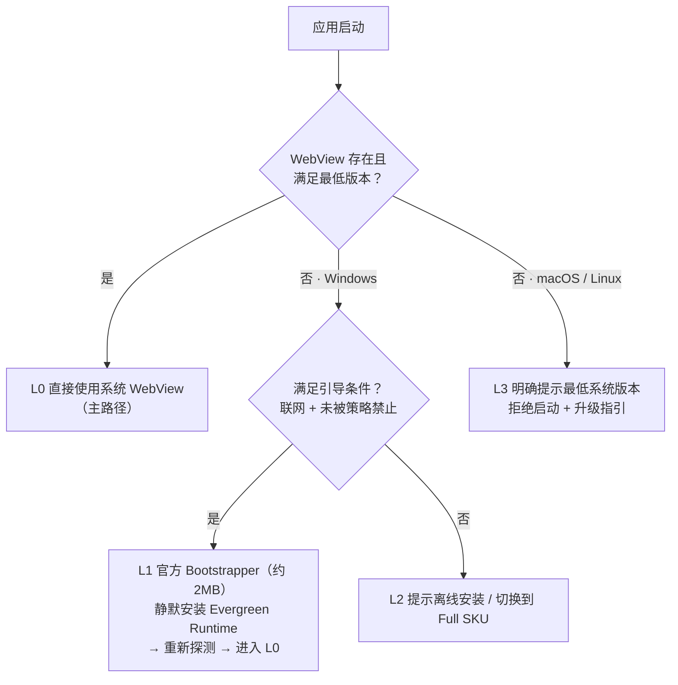
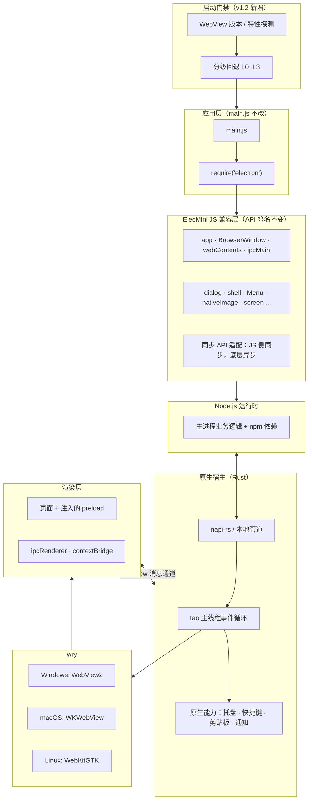
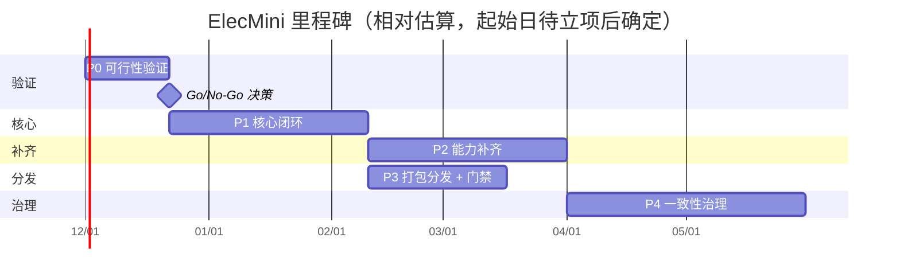

# ElecMini 技术方案与路线图

> **项目代号**：ElecMini（备选名：ElecLite / NanoTron / ShellBridge）
> **文档版本**：v1.2（最低 WebView 版本门禁 + 分级回退版）
> **日期**：2026-11-24
> **状态**：提案（已审阅，待 P0 可行性验证后立项）
> **一句话定位**：Electron 的 JS API 契约 + Node.js 主进程 + 系统 WebView 渲染层——换掉 Chromium，主进程代码不改；用版本门禁 + 分级回退解决"系统 WebView 太旧"的问题。架构见 [4.1 架构图](#41-架构图)，门禁设计见 [3.5](#35-最低-webview-版本门禁与分级回退)，修订说明见 [附录 C](#附录-c--修订记录)。

---

## 目录

1. [项目概述](#一项目概述)
2. [背景与动机](#二背景与动机)
3. [关键技术决策](#三关键技术决策)
   - [3.5 最低 WebView 版本门禁与分级回退](#35-最低-webview-版本门禁与分级回退)
4. [总体架构](#四总体架构)
5. [API 兼容性台账](#五api-兼容性台账)
6. [技术选型](#六技术选型)
7. [实施路线图](#七实施路线图)
8. [风险登记册](#八风险登记册)
9. [安全与合规要点](#九安全与合规要点)
10. [资源与团队要求](#十资源与团队要求)
11. [立项建议与下一步](#十一立项建议与下一步)
12. [附录](#附录-a--参考资源)

---

## 一、项目概述

### 1.1 定位

ElecMini 是一个**桌面应用运行时**。它对上层保留 Electron 的 JavaScript API 契约（`app` / `BrowserWindow` / `ipcMain` / `ipcRenderer` / `contextBridge` 等），对下层把 Chromium 内核替换为操作系统自带的 WebView（Windows WebView2 / macOS WKWebView / Linux WebKitGTK）。

**核心命题**：让一个现有的 Electron 应用，在**主进程代码不改**的前提下，显著减小安装包、降低空闲内存，并明确列出渲染侧必须接受的降级点。

### 1.2 核心指标（P0 已实测，2026-11-24；详见 docs/p0/README.md）

| 指标 | Electron | ElecMini 实测 | 说明 |
|---|---|---|---|
| 安装包体积 | electron dist 解压 **274MB**（本次实测） | host 二进制 **1.5MB**（实测）；Slim 预计 30~40MB / Full 150~250MB | Slim 需随包分发 Node（~83MB）+ Rust 宿主；包体收益显著（约 65~75%）✅ |
| 空闲内存（进程树 RSS） | **~558MB**（本次实测，Linux） | **~445MB**（实测：host 144 + WebProcess 256 + Network 45） | **约 80%，未达 Go/No-Go 的 ≤60% 门槛** ⚠️ 系统 WebView 同为多进程，内存收益有限 |
| 冷启动 | 公开数据 1~3 秒 | **~345ms**（实测中位数，到事件循环就绪） | ✅ 优秀；首次引导安装另计 |
| 渲染一致性 | 全平台同一 Chromium | 三套引擎，随用户系统升级而变化 | 最大长期成本，见 R1、R7 |
| 运行时依赖 | 无（自带 Chromium） | Slim 依赖系统 WebView 或在线引导；Full 自带 | 见 3.5 |

> **P0 实测结论**：技术机制全部跑通，但**内存收益未达预期**（约 80%，非 60%）。若立项动机主要是"省内存"，需重新评估；若主要是"省包体 + 冷启动"，收益明确。Go/No-Go 判定见 `docs/p0/README.md` 第九节。

### 1.3 目标 / 非目标

| 目标（Must） | 非目标（Out of Scope） |
|---|---|
| 去掉 Chromium，使用系统 WebView | 追求与 Electron 100% 的 API 一致性 |
| 保留 Node.js 主进程与全部主进程业务逻辑 | 提供完整的 Chromium 特性（沙箱、真隔离） |
| **目标应用的实际 API 调用点 100% 有归属**（原生实现 / 降级实现 / 明确放弃并经业务方确认） | 在游戏 / 重度图形 / 专业设计场景替代 Electron |
| 三平台可运行、可打包、可分发 | 短期内的生产级 SLA 承诺 |
| **启动时校验 WebView 能力，不满足时按平台分级处理，绝不白屏** | 在任何系统上都强行跑起同一颗引擎（macOS 做不到，见 3.5.1） |
| 建立清晰的兼容清单与降级方案 | 重新发明打包 / 签名 / 自动更新生态（优先复用） |

### 1.4 "不改业务代码"的准确含义

**主进程代码（main.js）目标为零修改。渲染侧存在已知破坏点**，必须在《目标应用 API 差异报告》中逐条确认：

| 破坏点 | 原因 | 对策 |
|---|---|---|
| preload 里的 `require('electron')` | 渲染层没有 Node | 以初始化脚本方式注入 preload，并提供 `require` 的受限垫片（仅 `electron` / `events` / `timers` / `url`） |
| IPC 传输 Buffer / ArrayBuffer / Map / Set / 自定义类型 | 系统 WebView 的消息通道只保证 JSON | 用带类型标签的封装（如 `{__t:'Buffer', b:'base64'}`）在两端还原 |
| `nodeIntegration: true` | 渲染层无法直接 `require('fs')` | **不支持**。需把调用改走 IPC，或放弃迁移 |
| `webSecurity: false` 绕过 CORS | 没有等价开关 | 用自定义协议承载本地页面，或让 Node 侧做请求代理 |
| `remote` 模块 | 已废弃 | 不支持 |
| 第三方库通过 UA / 特性检测判断"是否 Electron" | UA 不同、Chromium 版本随系统 | 主进程覆盖 UA 追加 `Electron/x.y`；构建目标重新设定，见 2.3 |

---

## 二、背景与动机

### 2.1 Electron 的成本

Electron = Chromium + Node.js。每个应用都打包一整颗浏览器内核，对"工具类、内部工具、需要频繁更新"的应用，这套成本尤其难受。

### 2.2 为什么现在可行

同类机制已有多个可运行实现，证明"JS 运行时后端 + 系统 WebView"这条路走得通：

| 参考项目 | 做法 | 成熟度 | 可借鉴点 |
|---|---|---|---|
| **Gelectron** | Rust 宿主进程（tao + wry）+ Node 兼容 shim + packager | 早期。官方自述"部分 API 为桩或空实现"，建议先用自己的应用实测 | 60 个模块的兼容清单与骨架，可作为 P0 的起点 |
| **Electrobun** | TypeScript 主进程（Bun）+ 系统 WebView + 自带差量更新器 | 已有正式版本与完整工具链 | 与本项目定位最接近：验证了包体量级、IPC 设计、更新方案 |
| **native-window** | napi-rs addon，让 Node 直接开系统 WebView 窗口 | 较新 | napi-rs 桥接、IPC 加固 |
| **Tauri** | wry + tao 的工业级封装 | 生产级 | 窗口 / IPC / 打包 / 签名 / 更新器的参考实现，见路线 B2 |

> **修正**：v1.0 称"Gelectron 已铺好约 70% 的路"没有依据。它的台账里 7 个模块是桩、35 个做不到，且项目处于早期。正确的定位是：**P0 从 Gelectron 起步以节省骨架搭建时间，不把它当作可依赖的地基**。Fork 前必须确认其许可证与最近提交时间。

### 2.3 一个容易被忽略的前提：渲染引擎版本不再由你控制

Electron 应用随包带着固定的 Chromium，所以前端构建目标可以很新。换成系统 WebView 后：

- **macOS**：JS / CSS 特性取决于用户的 macOS 版本（Safari 内核）。
- **Windows**：WebView2 Evergreen 运行时由微软自动更新，可能与应用发布时间错开。
- **Linux**：WebKitGTK 版本取决于发行版，老发行版可能缺少 libwebkit2gtk-4.1。

**对策**：设定最低版本基线并在启动时校验（见 3.5）；前端构建链重新设定目标（browserslist 对齐最低 macOS 的 Safari 版本），并在 CI 上覆盖"最低支持系统版本"的机器。

---

## 三、关键技术决策

### 3.1 三条路线

| 路线 | 做法 | 可行性 | 结论 |
|---|---|---|---|
| **A. Fork Electron C++ 源码换渲染层** | 把 `content` 模块替换成系统 WebView | ❌ 不可行 | `BrowserWindow` / `webContents` / `session` / 沙箱 / CDP / preload 隔离全部构建在 Chromium `content` 之上，替换等于重写整个渲染子系统 |
| **B1. 自研宿主：Rust 宿主 + napi-rs + wry/tao** | 自建原生宿主，Node 逻辑经 napi-rs 与之通信，自行搞定打包 / 签名 / 更新 | ✅ 可行，工作量大 | 可行路线之一 |
| **B2. Tauri 壳 + Node sidecar + electron shim** | 窗口 / IPC / 打包 / 签名 / 更新器直接用 Tauri，Node 作为 sidecar 进程承载主进程逻辑，`require('electron')` 指向 shim | ✅ 可行，风险更低 | **P0 与 B1 对比后二选一** |

### 3.2 决策结论

> **采用路线 B（B1 或 B2）：主进程代码不改，只替换 `require('electron')` 背后的实现。**

B1 与 B2 的取舍：

| 维度 | B1 自研宿主 | B2 Tauri 壳 + Node sidecar |
|---|---|---|
| 打包 / 签名 / 自动更新 | 全部自研 | **复用 Tauri** |
| 进程模型自由度 | 高 | 受 Tauri 约束，多一跳转发（renderer → Rust → Node） |
| IPC 延迟 | 一跳 | 多一跳，需实测（通常 < 1ms 量级，需验证） |
| Rust 工作量 | 大 | 小 |
| 适合 | 对进程模型有强定制需求 | 1 名 Rust 工程师以内的小团队 |

**建议**：小团队默认评估 B2，把自研范围压缩到"shim + 少量 Rust 胶水"。若 B2 的 IPC 延迟或事件时序无法满足，再转 B1。

### 3.3 第一技术风险：主线程归属与同步 API

这是 v1.0 完全没有覆盖、但决定项目成败的问题。

**问题一：主线程归谁。**
tao 的事件循环在 **macOS 上必须跑在进程主线程**，而 Node 默认也占用主线程的事件循环。两者不能同时独占主线程。可选模型：

| 宿主模型 | 做法 | 平台约束 |
|---|---|---|
| M1：Rust 宿主持有主线程，Node 在副线程或作为子进程 | Gelectron 即此类（Rust 宿主进程跑 tao，另有 N-API 相关 crate） | 三平台可行；Node 的宿主方式（嵌入 vs 子进程）需读源码确认 |
| M2：Node 持有主线程，tao 在副线程 | 最直接的 napi-rs 方案 | **macOS 不可行**，Windows / Linux 可行 |

**问题二：同步 API。**
Electron 大量 API 是同步返回的：`new BrowserWindow()` 同步返回对象，`win.getBounds()`、`webContents.getURL()`、`dialog.showOpenDialogSync()`、`screen.getPrimaryDisplay()` 等。跨线程调用时 shim 必须做到"JS 侧同步、底层异步"且结果正确，否则现有主进程代码会读到空值。

**结论**：P0 必须优先验证这两点（见 7.2 的 S1、S2）。它们不过，其余工作都没有意义。

### 3.4 能力边界（按平台，而非一刀切）

v1.0 把"网络拦截 / 真隔离 / CDP"列为"系统 WebView 做不到"，这个结论**过于绝对**。实际情况：

| 能力 | Windows（WebView2） | macOS（WKWebView） | Linux（WebKitGTK） |
|---|---|---|---|
| 网络请求拦截 | **可做**。原生 `WebResourceRequested` 事件 + `AddWebResourceRequestedFilter`；另有 CDP `Fetch.enable` | 仅自定义 scheme；通用拦截需降级 | 需 Web Extension，wry 层支持有限 |
| CDP | **可用**。`CallDevToolsProtocolMethod` + `GetDevToolsProtocolEventReceiver` | 无 | 有 Web Inspector，自动化能力弱 |
| DevTools | **完整 Chromium DevTools**（`OpenDevToolsWindow`、远程调试端口） | Web Inspector | Web Inspector |
| preload 隔离世界 | 初始化脚本默认运行在主世界 | 有 `WKContentWorld`，可做隔离世界 | 以主世界为主 |
| 自定义协议 | 支持 | 支持 | 支持 |
| 屏幕捕获 | 支持 `getDisplayMedia` | 受限 | 受限 |

**真正绕不过的约束**只有两条：

1. **渲染一致性**：三套引擎、版本随系统漂移，必须建立兼容基线。
2. **隔离语义不等价**：`contextIsolation` 可以用注入时机 + 冻结对象 + 隔离世界（macOS）模拟，但安全性弱于 Electron，威胁模型需要重做（见第九章）。

### 3.5 最低 WebView 版本门禁与分级回退

> **v1.2 新增**。需求是"系统 WebView 版本不够时自动下载一个浏览器兜底"。这个需求本身成立，但直接下载 Chrome / Chromium 有三个走不通的地方，必须改成平台特定的分级策略。

#### 3.5.1 为什么不能直接下载 Chrome / Chromium

| 想法 | 事实 |
|---|---|
| 下载 Chrome 当 WebView 用 | **Chrome 是浏览器应用，不是可嵌入控件**。可嵌入的只有 WebView2 Runtime / CEF / WKWebView / WebKitGTK |
| 下载 Chromium / CEF 兜底 | WebView2 Fixed Version **>250MB**、CEF **150~250MB**，与 Electron 同量级；且应用方要自己承担安全更新。直接推翻轻量化立项依据 |
| macOS 也这么干 | App Store 分发要求渲染网页必须用系统 WebKit；"下载并执行代码"还受 Guideline 2.5.2 约束。企业签名分发可绕过部分限制，但不能替换引擎 |
| 企业内网无法访问下载源 | 自动下载会失败，必须有离线兜底，否则白屏 |

**结论**：把"下载浏览器"改成三件事——**最低版本门禁** + **Windows 官方运行时引导** + **离线兜底 SKU**。

#### 3.5.2 最低版本基线（Capability Baseline）

版本号不是拍脑袋定的，而是从目标应用实际用到的 Web 特性反推，并且**版本判断 + 特性探测双保险**（版本号可能被伪装，特性探测才反映真实能力）。

| 平台 | 建议最低要求（P0 实测后定稿） | 对应能力 | 不满足时 |
|---|---|---|---|
| Windows | WebView2 Runtime ≥ 120，或 Evergreen 最新版 | CSS `:has`、`structuredClone`、ES2022 等目标应用实际用到的特性 | 进入 L1 引导安装 |
| macOS | macOS 12+（WebKit 随系统，无独立版本可供应用升级） | 同上 | **无法补救**，拒绝启动并引导升级系统 |
| Linux | WebKitGTK ≥ 2.40（Ubuntu 22.04+ 默认） | 同上 | 进入 L3 提示 / 改用 Full SKU |

**探测实现**：在 Node 主进程里完成，不能等到窗口创建后（否则先白屏再报错）。
- Windows：读注册表 `pv` 值（`HKLM` 与 `HKCU` 两处），并调用 `GetAvailableCoreWebView2BrowserVersionString` 复核。
- 三平台通用：WebView 创建后跑一段特性探测脚本（`CSS.supports(...)`、`typeof structuredClone`、`Array.prototype.at` 等），结果写入启动日志。

#### 3.5.3 分级回退（Cascade）

| 层级 | 触发条件 | 动作 | 用户体验 |
|---|---|---|---|
| **L0** | 系统 WebView 满足基线 | 正常启动 | 无感知，覆盖绝大多数机器 |
| **L1（仅 Windows）** | Runtime 缺失或过旧，且联网、未被企业策略禁止 | 调用**官方 WebView2 Bootstrapper**（约 2MB，固定微软官方域名），静默安装 **Evergreen** Runtime（系统共享、自动安全更新），完成后重新探测 | 显示"正在准备运行环境（约 100MB，仅首次）"，可取消 |
| **L2** | L1 失败：离线、无权限、组策略禁止 | 给出明确的离线安装包指引，或改发 Full SKU | 清晰提示，**不白屏** |
| **L3（macOS / Linux）** | 系统版本过低且无法替换引擎 | 拒绝启动，提示最低系统版本与升级路径 | 清晰提示，**不白屏** |

**关键点**：L1 装的是 **Evergreen**（微软自动更新），不是 Fixed Version。这既解决了"版本太旧"，又不把安全更新责任揽到自己身上——这正是它优于"下载 Chromium"的地方。

#### 3.5.4 两条发行 SKU

| SKU | 内容 | 体积 | 目标用户 |
|---|---|---|---|
| **Slim（默认）** | Node + shim + 宿主，依赖系统 WebView；Windows 带 2MB Bootstrapper | **30~40MB** | 联网、系统较新的大多数用户 |
| **Full（兜底）** | Slim + 内置 WebView2 Fixed Version（Windows）/ CEF（跨平台） | **150~250MB** | 离线、企业内网、要求锁定引擎版本的场景 |

两条 SKU 共用同一份业务代码与 shim，只差运行时打包方式。**Full 的存在是"保底可用"，不是主推产品**——它的体积与 Electron 相当，立项收益主要由 Slim 承担。是否长期维护 Full，依据 P0 遥测中 L1/L2 路径的实际占比决定。

#### 3.5.5 工程要点

1. 门禁在 **launcher 层**实现，对 `require('electron')` 和主进程代码完全透明。
2. Windows 下载必须：固定微软官方 URL、HTTPS、SHA256 校验 + Authenticode 签名校验、失败可重试、进度可见、可取消。**不允许从第三方镜像下载**。
3. 企业策略检测：读组策略/注册表，若禁止安装则跳过 L1 直接走 L2，避免卡在静默安装。
4. 遥测：记录 L0 / L1 / L2 / L3 的路径分布与失败原因，作为是否维护 Full SKU 的决策依据（默认关闭，企业可关闭）。
5. 严禁把"下载浏览器"做成静默无提示行为——下载 100MB 级组件必须告知用户并获得确认。

---

## 四、总体架构

### 4.1 架构图

以模型 M1 为例（B2 的差异：右侧"Tauri 壳"承担原生宿主与打包分发）：

### 4.2 分层职责

| 层 | 职责 | 技术 |
|---|---|---|
| 启动门禁 | 探测 WebView 版本与特性，决定 L0~L3 路径 | Node 主进程 + 注册表 / 特性探测 |
| 应用层 | 现有 Electron 主进程代码，零修改 | JS / TS |
| API 兼容层 | 逐个重写 Electron 模块，保持 API 签名与**同步 / 异步语义**一致 | JavaScript shim |
| Node 运行时 | 应用生命周期、业务逻辑、npm 依赖 | Node.js |
| 原生宿主 | 窗口事件循环、WebView 创建、原生能力、跨线程调度 | Rust + tao + wry + napi-rs |
| 渲染层 | 页面与 preload；经 WebView 消息通道与宿主通信 | 系统 WebView |

### 4.3 关键流程

**启动流程**：launcher 解析 `package.json` 的 `main` → **启动门禁探测 WebView 版本，不满足则按 3.5.3 分级处理** → 注入 require 钩子，把 `electron` 指向 ElecMini shim → 启动 Node 逻辑 → `new BrowserWindow()` 经 shim 请求原生宿主创建 tao 窗口 + wry WebView → 注入 preload → 加载目标 URL。

**IPC 流程**：renderer 调 `ipcRenderer.invoke()` → WebView 消息通道到原生宿主 → 转发到 Node 侧的 `ipcMain` handler → 返回值原路回传。**两端都经过类型封装层**，以还原 Buffer / ArrayBuffer 等非 JSON 类型。

**事件流程**：窗口事件（resize / close / focus）由 tao 产生 → 经宿主转发到 Node → shim 触发对应的 `win.on(...)` 回调，事件名与参数结构须与 Electron 一致。

---

## 五、API 兼容性台账

### 5.1 初筛台账（来自 Gelectron）

| 档位 | 模块 | 处理方式 |
|---|---|---|
| ✅ 完整可用（4） | `app`、`ipcMain`、`clipboard`、`Notification` | 直接沿用 / 少量适配 |
| 🟡 基本可用（14） | `BrowserWindow`、`webContents`、`ipcRenderer`、`dialog`、`shell`、`Menu`/`MenuItem`、`screen`、`nativeTheme`、`nativeImage`、`contextBridge`、`net` | 补齐常用方法，明确阉割清单 |
| 🟠 桩实现（7） | `Tray`、`session`、`safeStorage`、`autoUpdater`、`globalShortcut`、`powerMonitor`、`systemPreferences` | 需接 Rust 侧实现，工作量集中区 |
| ❌ 做不到（35） | `protocol`、`webRequest`、`desktopCapturer`、`utilityProcess`、`BrowserView`/`WebContentsView`、`webFrame`、`webFrameMain`、CDP、`contextIsolation` 真隔离 等 | 必须降级或找替代 |

### 5.2 本次审核的修正

| 条目 | 原判定 | 修正为 | 依据 |
|---|---|---|---|
| `protocol` | ❌ | 🟠 降级可支持 | wry 自定义协议可覆盖 `handle` / 文件协议的常见用法；`registerSchemesAsPrivileged` 仅部分等价，需验证 |
| `webRequest` | ❌ | Windows 🟡，mac / Linux 🟠 | 见 3.4 |
| CDP | ❌ | Windows 🟡 | `CallDevToolsProtocolMethod` |
| `desktopCapturer` | ❌ | Windows 🟡 | `getDisplayMedia` |
| `contextIsolation` | ❌ | ⚠️ 待验证 | macOS 有隔离世界；安全性语义不等价 |
| `utilityProcess` | ❌ | 🟡 | 直接映射到 `child_process.fork` / `worker_threads` |
| 调试能力 | "Windows 有限" | **Windows 完整** | WebView2 内置 Chromium DevTools |
| `BrowserView` / `WebContentsView` | ❌ | 🟠 待验证 | 以子 WebView 或子窗口模拟，取决于 wry 对单窗口多 WebView 的支持 |
| `webContents.print` / PDF 预览 | 未列 | ⚠️ 新增 | WebView2 有 `PrintToPdf` 与内置 PDF 阅读；WKWebView 的内嵌 PDF 能力需验证 |
| `nodeIntegration` | 未列 | ❌ | 渲染层无 Node，必须改造 |

### 5.3 台账的正确用法

**台账按"模块数量"分档没有决策价值**。一个应用可能只用 5 个模块，但其中 1 个用到了 ❌ 档的方法。因此 P0 的产出必须按**调用点**统计：

1. 用 AST 扫描目标应用：`electron` 的导入方式（默认导入 / 解构 / 具名）、每个模块上实际访问的属性与方法、`new BrowserWindow({...})` 的全部选项（尤其是 `webPreferences` 下的 `preload` / `nodeIntegration` / `contextIsolation` / `webSecurity` / `sandbox`）、`ipcMain.handle` 与 `ipcRenderer.invoke` 的通道名及负载类型。
2. 每个调用点标注：原生实现 / 降级实现 / 放弃。
3. "放弃"的每一项必须由业务方书面确认。

---

## 六、技术选型

| 层 | 选型 | 理由 |
|---|---|---|
| 窗口 / 渲染 | **wry + tao**（直接使用，或经 Tauri 间接使用） | 三平台 WebView 的事实标准封装 |
| **WebView 版本门禁** | **注册表 / API 版本探测 + 特性探测双保险** | 防止"有版本号但实际缺特性"导致运行期出错 |
| **Windows 运行时引导** | **官方 WebView2 Bootstrapper（约 2MB）→ Evergreen Runtime** | 系统共享、微软自动安全更新，远优于自带 Chromium |
| **离线兜底** | **Full SKU：Fixed Version / CEF，按需发行** | 只在必要时发布，不进默认包 |
| 原生桥接 | **napi-rs**（B1）或 **Tauri sidecar + 本地通道**（B2） | 保留 Node 生态，避开"后端强制 Rust" |
| 主进程 | **Node.js（随包分发）** | 与 Tauri 的根本差异，主进程代码零迁移 |
| API 兼容层 | **JS shim，逐模块重写** | `require('electron')` 指向 ElecMini 实现 |
| IPC | WebView 原生消息通道 + 类型封装层 | 三平台通道不同，由 wry 统一 |
| 打包 | Tauri bundler（B2）或自研 packager（B1），需支持双 SKU | 去掉 Chromium 相关逻辑 |
| 自动更新 | **Velopack 或 Sparkle，不自研** | 自研更新器的签名、差量、回滚成本高，已有成熟方案 |
| 调试 | WebView2 DevTools / Safari Web Inspector / WebKitGTK Inspector | 加 CDP（Windows）用于自动化 |
| 契约测试 | **同一套用例在真 Electron 与 ElecMini 上各跑一遍** | 差分结果即兼容度，防止 shim 语义漂移 |

---

## 七、实施路线图

### 7.1 阶段总览

| 阶段 | 名称 | 目标 | 估时 | 依赖 |
|---|---|---|---|---|
| **P0** | 可行性验证 | 8 个 spike 全部有结论；产出调用点清单、实测指标、门禁方案 | 2~3 周 | — |
| **P1** | 核心闭环 | 宿主模型落地，核心模块可用，真实应用跑通主流程 | 6~8 周 | P0 Go |
| **P2** | 能力补齐 | 目标应用用到的 🟠 档降为真实实现 | 6~8 周 | P1 |
| **P3** | 打包分发 | **双 SKU** 可安装产物、签名、自动更新、门禁闭环 | 4~6 周（B2）/ 6~8 周（B1） | P1 |
| **P4** | 一致性治理 | 兼容基线、调试方案、灰度上线 | 持续 | P2 / P3 |

**核心开发总量约 18~25 周**（1 名 Rust + 1~2 名 JS 全职，不含 P4）。

> **修正**：v1.0 的"9~13 周"低估了同步语义适配、跨线程调度、打包签名与更新器的成本。v1.2 进一步加入了门禁与双 SKU（P3 增加约 1 周）。

### 7.2 P0 · 可行性验证（2~3 周）

| 编号 | Spike | 通过标准 |
|---|---|---|
| S1 | 宿主模型：三平台跑通窗口开闭，同时 Node 侧 `setInterval` 每 100ms 触发不卡顿 | 三平台窗口可开可关，定时器无丢帧；明确 M1 / M2 取舍 |
| S2 | 同步 API：`new BrowserWindow()` 同步返回对象；`getBounds()` 返回真实值 | 一段不改的 Electron 窗口初始化代码可直接运行 |
| S3 | preload + IPC：注入 preload，`contextBridge.exposeInMainWorld`，`invoke` 往返 | Buffer / ArrayBuffer / Map 往返后类型保持 |
| S4 | Windows 能力探底：`WebResourceRequested` 改请求头、`CallDevToolsProtocolMethod`、`OpenDevToolsWindow` | 三项均可用 |
| S5 | 指标实测：包体、空闲内存（含 WebView 进程树）、冷启动 | 三平台各 5 次取中位数，产出数据表替换 1.2 |
| S6 | API 扫描：AST 扫描目标应用 | 产出《调用点清单 + 删减清单》，每一项有归属 |
| S7 | 路线选型：B1 与 B2 各做一个最小 IPC 往返 | 给出 IPC 延迟数据与选型结论 |
| **S8** | **版本门禁与引导（v1.2 新增）**：在缺失/低版本 WebView2 的干净 Win10 虚拟机上跑 Slim 包；断网、组策略禁止两种失败路径 | L1 自动安装成功并启动；L2 给出清晰提示而非白屏；macOS 低版本给出明确提示；探测结果有日志 |

**交付物**：三平台 Demo、《目标应用 API 差异报告》、《实测指标报告》、《路线选型结论》、《WebView 版本门禁设计》。

**Go / No-Go 标准**（四条同时满足才 Go）：

1. S1~S4、S8 全部通过。
2. 目标应用的 ❌ 档调用点为零，或每一项都有替代方案并经业务方确认。
3. 实测包体不超过 Electron 的 40%，空闲内存不超过 Electron 的 60%。达不到则收益不足以覆盖长期维护成本，**建议不立项**。
4. **L0 路径覆盖率预估 ≥ 95%**（依据目标用户群的系统版本分布），否则门禁与双 SKU 的维护成本不划算。

### 7.3 P1 · 核心闭环（6~8 周）

- **任务**：宿主模型落地；实现 `app`、`BrowserWindow`、`webContents`、`ipcMain` / `ipcRenderer`、`contextBridge`、`dialog`、`shell`、`Menu`；窗口事件转发；IPC 类型封装层；**启动门禁的探测与 L0 路径**；建立 Electron / ElecMini 差分契约测试框架。
- **交付物**：能加载目标应用并完成前后端通信的运行时。
- **验收标准**：目标应用主流程跑通；差分契约测试覆盖 P1 全部模块；门禁不干扰正常启动。

### 7.4 P2 · 能力补齐（6~8 周）

- **任务**：只补目标应用实际用到的模块（按 S6 清单），常见为 `Tray`、`nativeImage`、`screen`、`nativeTheme`、`safeStorage`、`globalShortcut`、`session`、`protocol`。
- **交付物**：调用点清单中的"降级实现"全部变为真实实现，或有明确记录的剩余项。
- **验收标准**：目标应用回归用例全部通过；差分契约测试扩展到 P2 模块。

### 7.5 P3 · 打包分发（4~6 周，B2）

- **任务**：接入打包器；代码签名（Windows Authenticode、macOS Developer ID + 公证）；接入 Velopack / Sparkle；**实现 L1 引导安装与 L2 提示**；**产出 Slim / Full 双 SKU**；WebView2 运行时的离线安装包准备。
- **交付物**：三平台 Slim 产物 + 按需 Full 产物（exe / dmg / AppImage 或 deb）。
- **验收标准**：干净机器安装后，L0/L1/L2 三条路径均可正确到达；更新流程含签名校验与回滚。

### 7.6 P4 · 一致性治理（持续）

- **任务**：建立 CSS / JS 兼容基线；CI 覆盖最低支持系统版本；截图对比；**门禁路径遥测与 L0 覆盖率跟踪**；灰度发布；跟踪系统 WebView 版本变化。
- **交付物**：《渲染兼容基线》+ CI 检查 + 灰度报告 + 门禁路径分布报告。
- **验收标准**：三平台关键页面视觉与交互差异在可接受范围；L1/L2 占比持续低于维护 Full SKU 的盈亏平衡点。

### 7.7 里程碑时间线

---

## 八、风险登记册

| ID | 风险 | 概率 | 影响 | 对策 |
|---|---|---|---|---|
| R1 | 三套 WebView 渲染差异导致 UI 错乱 | 高 | 高 | 建立兼容基线；CI 三平台截图对比；前端构建目标重新设定 |
| R2 | 安全模型退化（隔离语义不等价） | 高 | 高 | 见第九章；威胁模型重做并评审 |
| R3 | 主线程归属 / 同步 API 方案在某个平台走不通 | 中 | 高 | P0 的 S1、S2 前置验证，不通过即止 |
| R4 | 系统 WebView 版本随用户环境漂移，线上行为不可控 | 高 | 中 | **最低版本门禁（3.5）**；CI 覆盖最低版本；变更监控 |
| R5 | Linux WebKitGTK 版本碎片化、历史安全漏洞多 | 中 | 中 | 明确支持的发行版清单；评估是否只支持 Ubuntu 22.04+ |
| R6 | 上游 Gelectron 活跃度低、许可证不明 | 中 | 中 | Fork 前确认许可证；只借鉴骨架，不形成依赖 |
| R7 | 自动更新与签名工作量被低估 | 中 | 中 | 不自研，用 Velopack / Sparkle 或 Tauri updater |
| R8 | IPC 负载类型降级导致数据损坏 | 中 | 高 | 类型封装层 + 差分契约测试覆盖全部通道 |
| R9 | 实测收益不达预期（尤其是内存） | 中 | 高 | Go / No-Go 第 3 条硬性卡住 |
| R10 | 团队无 Rust / 原生平台经验 | 中 | 高 | 优先 B2；P0 引入有 AppKit / Win32 经验的顾问做评审 |
| R11 | 旧系统不支持 WebView2（Win7 / 8 已停止支持） | 低 | 低 | 明确最低系统要求为 Windows 10；L3 明确提示 |
| **R12** | **运行时引导安装失败（离线 / 代理 / 组策略），用户卡住** | **中** | **高** | L2 明确提示与离线包指引；S8 覆盖三种失败路径；绝不静默白屏 |
| **R13** | **下载组件被劫持 / 供应链攻击** | **低** | **高** | 固定官方域名 + HTTPS + SHA256 + Authenticode 校验；禁止第三方镜像；见第九章 |
| **R14** | **L1/L2 占比过高，Full SKU 与双线维护成本失控** | **中** | **中** | 门禁路径遥测；设定盈亏平衡点；不达标则收窄支持系统范围 |

**关于"双轨制"**：v1.0 提议用 manifest 声明 `renderer: chromium | system-webview` 做运行期切换。这实际上是**构建期选择**——切回 Chromium 就意味着随包分发 Chromium，即回到 Electron 安装包。v1.2 把它具体化为 **Slim / Full 双 SKU**（见 3.5.4）。前提是 shim 语义不漂移，这正是差分契约测试的意义。

---

## 九、安全与合规要点

替换渲染层后，Electron 的安全假设不再成立，必须重新做威胁模型：

1. **IPC 入口鉴权**：只有受信 origin 可以调用 IPC；导航到外部 origin 时断开通道；校验发起 frame。
2. **消息约束**：每个通道声明参数 schema；限制消息大小与频率；拒绝未注册的通道。
3. **暴露面最小化**：`contextBridge` 暴露的对象冻结；禁止把任何 Node 对象引用或函数句柄泄漏到渲染侧；`nodeIntegration` 不提供。
4. **网络策略**：默认只允许应用自身 origin 与白名单域；Windows 上用 `WebResourceRequested` 落地策略，其他平台用 CSP 注入。
5. **分发安全**：macOS 开启 hardened runtime 并公证；Windows 代码签名；更新包签名校验。
6. **审计**：无 CDP 审计（mac / Linux）时，用日志埋点覆盖 IPC 调用。
7. **运行时下载安全（v1.2 新增）**：Bootstrapper 只从微软官方域名获取，固定 URL；下载后校验 SHA256 与 Authenticode 签名；失败不重试无限循环；**下载 100MB 级组件必须告知用户并获得确认**；企业环境下尊重组策略，禁止时跳过 L1。
8. **macOS 合规（v1.2 新增）**：App Store 分发必须使用 WKWebView，不得捆绑或下载替换渲染引擎；"下载并执行代码"受 Guideline 2.5.2 约束，门禁在 macOS 上只做版本检查与提示，不执行任何下载。

---

## 十、资源与团队要求

| 角色 | 职责 | 投入 |
|---|---|---|
| JS / Node 工程师（1~2） | shim、IPC 类型封装层、差分契约测试、**启动门禁（探测 / 引导 / 提示）** | 全程 |
| Rust 工程师（1） | 原生宿主或 Tauri 胶水、原生能力、打包 | P0~P3 |
| 测试（1，可兼任） | 三平台兼容基线、截图对比、回归、**门禁失败路径测试（S8）** | P0 起 |
| 发布 / 运维（兼） | 签名、更新、灰度、**双 SKU 与离线包维护** | P3 起 |

**硬门槛**：至少一人有原生平台经验（macOS AppKit 主线程规则、Win32 消息循环）。没有的话，R3 的风险无法在评审阶段识别。

---

## 十一、立项建议与下一步

### 11.1 建议

- 技术上可行，但本质是"重写 Electron 的实现层"，不是小修小补。
- **收益需要重新校准**：Slim 包体预计减少约 65~75%，内存收益待实测。如果立项动机主要是"省内存"，先看 P0 的 S5 结果。
- **"功能不删减"要打引号**：主进程常用 API 能保住；渲染侧的 `nodeIntegration`、`webSecurity: false`、`remote` 等必须改造。
- **"系统 WebView 太旧"的解法是门禁 + 引导，不是下载 Chrome**：Windows 用官方 Bootstrapper（2MB）装 Evergreen；macOS 只能要求系统版本；Full SKU 兜底离线场景。见 3.5。
- **立项门槛**：P0 的四份交付物（差异报告、实测指标、路线选型、门禁设计）是 Go / No-Go 的唯一依据。

### 11.2 立即执行清单

1. **指定目标应用**：没有具体应用，差异报告与最低版本基线都无法确定。这是当前最前置的事项。
2. **确认 Gelectron 许可证与活跃度**，决定 fork 还是从零搭骨架。
3. **确定目标用户群的系统版本分布**：用于估算 L0 覆盖率（Go / No-Go 第 4 条）与最低版本基线。
4. **拉起 P0**：按 7.2 执行 8 个 spike，其中 S8 需要一个干净的 Win10 虚拟机。
5. **评审决策**：按 Go / No-Go 四条标准判定。

---

## 附录 A · 参考资源

- [Electron 官网](https://electronjs.org/zh/) · [进程模型](https://www.electronjs.org/docs/latest/tutorial/process-model)
- [Gelectron](https://github.com/mileswolfallen2/gelectron) · [API 兼容清单](https://github.com/mileswolfallen2/gelectron/blob/main/ELECTRON_API_STATUS.md)
- [Electrobun 与 Electron / Tauri 对比（含包体实测）](https://electrobun.dev/electrobun/vs)
- [native-window](https://nativewindow.fcannizzaro.com/)
- [wry](https://github.com/tauri-apps/wry) · [Tauri](https://tauri.app/)
- [**WebView2 分发指南（Bootstrapper / Standalone / Fixed Version）**](https://learn.microsoft.com/en-us/microsoft-edge/webview2/concepts/distribution)
- [**WebView2 Evergreen vs Fixed Version 对比**](https://learn.microsoft.com/en-us/microsoft-edge/webview2/concepts/distribution#evergreen-vs-fixed-version)
- [WebView2 CDP 拦截讨论](https://github.com/MicrosoftEdge/WebView2Feedback/issues/2842)
- [Neutralinojs 文档](https://neutralino.js.org/docs)
- [Apple App Store Review Guidelines（2.5.2 / 2.5.6）](https://developer.apple.com/app-store/review/guidelines/)

## 附录 B · 术语表

| 术语 | 含义 |
|---|---|
| wry | Tauri 系的跨平台 WebView 封装库（Rust） |
| tao | Tauri 系的跨平台窗口管理库（Rust） |
| napi-rs | 用 Rust 编写 Node.js 原生插件的框架 |
| sidecar | 随主程序一起分发的辅助可执行进程 |
| WebView2 / WKWebView / WebKitGTK | 三平台的系统 WebView |
| Evergreen Runtime | WebView2 的共享运行时，由微软自动更新 |
| Fixed Version Runtime | 随应用分发的固定版本运行时，由应用方自行更新 |
| Bootstrapper | 约 2MB 的在线安装引导程序 |
| CEF | Chromium Embedded Framework，可嵌入的 Chromium，体积 150~250MB |
| CDP | Chrome DevTools Protocol |
| contextIsolation | Electron 的渲染上下文隔离机制 |
| 差分契约测试 | 同一用例分别在 Electron 与 ElecMini 上运行并比对结果 |
| L0 / L1 / L2 / L3 | 启动门禁的四级回退路径，见 3.5.3 |

## 附录 C · 修订记录

### v1.2-p4（2026-11-24，P4 一致性治理交付）
| 项 | 内容 |
|---|---|
| 范围 | 7.6 一致性治理：兼容基线、CI、截图对比、门禁遥测、灰度、版本跟踪 |
| 遥测 | `runtime/telemetry.js` 默认关闭/无 PII/脱敏/JSONL；闭环 21/21；L0 覆盖率 + 盈亏平衡（R14）判定 |
| 兼容基线 | `compat/` baseline + ES5 特性探测（4 CSS + 7 JS）+ headless CLI；自测 8/8 + chromium 实跑通过 |
| CI | `ci/check.sh` + GitHub Actions（ubuntu-22.04）；全套 11/11 通过 |
| 截图对比 | `visual/` capture + Pillow 像素/phash 对比；相同图 0% pass、改背景 71.7% fail |
| 灰度 | `pack/gray.js` 确定性分桶 + 白黑名单/Kill switch，13/13；`watch-webview.js` 版本监控实测 WebKitGTK 2.52.6 |
| 报告 | `docs/p4/README.md` + 门禁分布报告 + 灰度报告 + `CHANGELOG-P4.md` |
| 限制 | 真实 L1/L2 占比需生产遥测回填；三引擎截图仅 Chromium 实跑；CI 覆盖能力基线非最低版本机器 |

### v1.2-p3（2026-11-24，P3 打包分发交付）

| # | 修订内容 | 原因 |
|---|---|---|
| 1 | P3 打包分发：双 SKU 打包器（Slim/Full × 三平台目录布局 + manifest）、产物启动器、门禁引导状态机（decide→install→verify）、代码签名脚本、自动更新（Velopack/Sparkle + 校验 + 回滚） | 按 7.5 执行，交付见 `/workspace/elecmini/docs/p3/README.md` |
| 2 | 门禁闭环实测：状态机 6/6 分支，launcher L0 直通 / L2·L3 提示拦截不白屏；旧 `ELECMINI_GATE=block` 兼容 | L1 真实安装受 wine Omaha/OOBE 限制，逻辑闭环已验证，渲染需真实 Windows |
| 3 | 包体实测：Slim 压缩后 41MB（Electron 274MB 的 15%），优于 Go 标准 40% 上限 | Node v22 二进制为主要来源；内存结论不变（P0 PSS 修正） |
| 4 | 更新器自测 5/5（生成/校验/校验失败检出/应用/回滚）；签名三平台 dry-run 正确 | 无证书环境产出可配置脚本 + dry-run，真实签名需凭据 |
| 5 | 剩余项：真实 Windows 安装渲染、真实签名/公证、NSIS/dmg/AppImage/deb 实际编译、门禁遥测（P4） | 需真实平台/凭据/渠道；衔接 P4 |

### v1.2-p2（2026-11-24，P2 能力补齐交付）

| # | 修订内容 | 原因 |
|---|---|---|
| 1 | P2 能力补齐：screen/nativeTheme 真实系统探测、safeStorage 真实加密（openssl）、protocol（app:// 自定义协议）、dialog 原生（zenity）、clipboard 真实（xclip）、session/powerMonitor/systemPreferences 实装；Tray/globalShortcut 保留 API 形状 + 明确降级 | 按 7.4 执行，交付见 `/workspace/elecmini/docs/p2/README.md` |
| 2 | 差分契约扩展：23 → 38 用例，38 MATCH / 0 DIFF | 覆盖 P2 全部模块 API 签名/形状；平台相关行为值不作断言 |
| 3 | 用系统工具（openssl/xclip/zenity）替代重量级 crate | 降低编译成本、规避 Xvfb 兼容问题；记录 AEAD 限制与降级边界 |
| 4 | 修复：safeStorage（openssl enc 不支持 GCM → CBC + `-A`）、clipboard（xclip pipe EOF 卡死 → spawn 后台化）、nativeTheme（方法 → boolean 属性） | E2E 与差分测试暴露的真实 bug |
| 5 | 剩余项：Tray/globalShortcut 真原生需桌面环境 crate；Windows WebRequest 需真实 Windows；真实目标应用仍为 11.2 阻塞项 | 明确记录，衔接 P3 |

### v1.2-p1（2026-11-24，P1 核心闭环交付）

| # | 修订内容 | 原因 |
|---|---|---|
| 1 | P1 核心闭环落地：B2 进程模型（Node sidecar + Rust host + JSON-RPC）、P1 全模块 shim、窗口事件转发、状态镜像同步 API、渲染层 preload、启动门禁 | 按 7.3 执行，交付位于 `/workspace/elecmini/`，报告见 `docs/p1/README.md` |
| 2 | 差分契约测试框架建成：同一探针应用在真 Electron 与 ElecMini 各跑一遍，23 用例 23 MATCH / 0 DIFF | 落实技术选型第 12 项与 7.3 验收标准 |
| 3 | 新增本地 HTTP server 承载 file:// 页面 | 规避 wry 0.52 WebKitGTK 对 file:// 的 IPC `InvalidUri` panic，符合 1.4 自定义协议承载建议 |
| 4 | 已知降级点更新：同步对话框抛错、Tray/session P2 未实现、executeJavaScript 无返回值、new BrowserWindow 后即时 getBounds 为期望值 | 差分测试暴露的语义边界，逐条记录 |
| 5 | 内存结论不变：P0 的 PSS 修正（约 107%）未被 P1 改变 | 系统 WebView 多进程栈的架构性事实，立项判断仍以此为准 |

### v1.2-p0（2026-11-24，P0 可行性验证实测回填）

| # | 修订内容 | 原因 |
|---|---|---|
| 1 | 1.2 核心指标表用 P0 实测值替换假设值 | P0 已在 Linux/WebKitGTK 2.52.6 环境实测：host 二进制 1.5MB、Electron dist 274MB、ElecMini 内存 ~445MB vs Electron ~558MB、冷启动 ~345ms |
| 2 | 确认内存收益约 80%，未达 Go/No-Go 第 3 条（≤60%） | 重要不利发现，立项判断需据此调整 |
| 3 | P0 交付物位于 `/workspace/elecmini/`，含可运行宿主、S2 同步验证、S6 扫描器、S3 类型单测、门禁设计 | 8 个 spike 的沙箱可验证部分全部有结论 |

### v1.2（2026-11-24，最低 WebView 版本门禁 + 分级回退）

| # | 修订内容 | 原因 |
|---|---|---|
| 1 | 新增 3.5 节：最低版本基线、特性探测、L0~L3 分级回退、双 SKU | 用户要求"版本不满足时自动下载兜底"；直接下载 Chrome/Chromium 不成立 |
| 2 | 明确 Windows 用官方 Bootstrapper（约 2MB）装 Evergreen，而非自带 Chromium | 系统共享 + 自动安全更新；Fixed Version >250MB 会推翻轻量化立项依据 |
| 3 | macOS / Linux 只能做版本检查与提示，不执行下载 | App Store 规则要求用系统 WebKit；下载执行代码受 2.5.2 约束 |
| 4 | 新增 Slim / Full 双 SKU（30~40MB / 150~250MB） | 兼顾轻量主路径与离线 / 企业内网兜底 |
| 5 | 架构图与启动流程加入门禁层；4.2 加"启动门禁"职责 | 门禁必须在窗口创建前完成，否则白屏 |
| 6 | 技术选型加门禁、运行时引导、离线兜底三项 | 明确实现方式 |
| 7 | P0 加 S8（门禁与引导，含干净 Win10 虚机）；Go/No-Go 加第 4 条 L0 覆盖率 ≥95% | 把新机制纳入验证与决策 |
| 8 | P3 估时上调、总量 17~23 周 → 18~25 周 | 门禁 + 双 SKU 增加约 1 周 |
| 9 | 风险从 11 条扩到 14 条（R12 引导失败 / R13 下载劫持 / R14 双 SKU 维护成本） | 新机制引入新风险 |
| 10 | 安全要点加运行时下载安全与 macOS 合规；立即执行清单加"系统版本分布" | 供应链安全与合规前置 |

### v1.1（2026-11-24，审核修订）

| # | 修订内容 | 原因 |
|---|---|---|
| 1 | 核心指标改为"假设值，待实测"；包体从 3~10MB 改为约 30~40MB | 必须随包分发 Node（node.exe v22 本体 83MB）；原数据来自不带 Node 的 Tauri |
| 2 | "不改业务代码"收窄为"主进程不改 + 渲染侧破坏点清单" | 原表述会误导立项判断 |
| 3 | 新增 3.3 主线程归属与同步 API，列为第一技术风险 | 决定成败却完全未覆盖 |
| 4 | 能力边界改为按平台矩阵 | WebView2 原生支持请求拦截、CDP、完整 DevTools，原"做不到"过于绝对 |
| 5 | 新增路线 B2（Tauri 壳 + Node sidecar） | 可复用打包 / 签名 / 更新器，降低 Rust 门槛 |
| 6 | 参考项目补充 Electrobun；删去"Gelectron 已铺好 70% 的路" | 前者是最接近的同类实现，后者无依据 |
| 7 | 估时从 9~13 周改为 17~23 周；P0 拆为 7 个带通过标准的 spike | 原估时未含同步语义、跨线程、打包签名 |
| 8 | 新增 Go / No-Go 量化标准 | 原标准只有定性描述 |
| 9 | 自动更新改为复用 Velopack / Sparkle | 自研成本高且已有成熟方案 |
| 10 | 风险从 6 条扩到 11 条 | 补齐运行时漂移、Linux 碎片化、IPC 类型、上游依赖等 |
| 11 | 新增安全要点、调用点 AST 扫描、差分契约测试 | 隔离语义变化后威胁模型需重做；按模块数分档无决策价值 |
| 12 | 甘特图去掉 done / active 状态；双轨制澄清为构建期选择 | 文档状态是提案；运行期切换不成立 |
