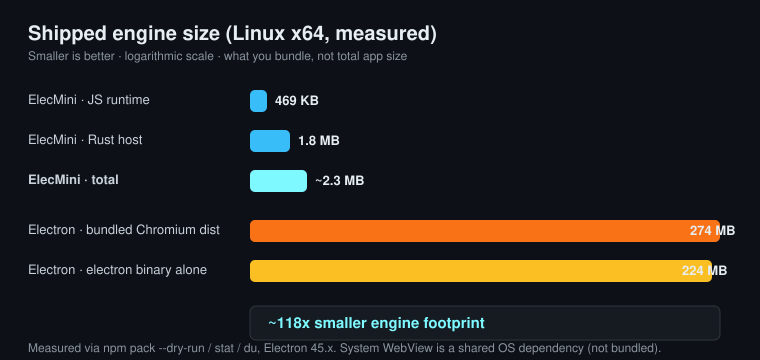
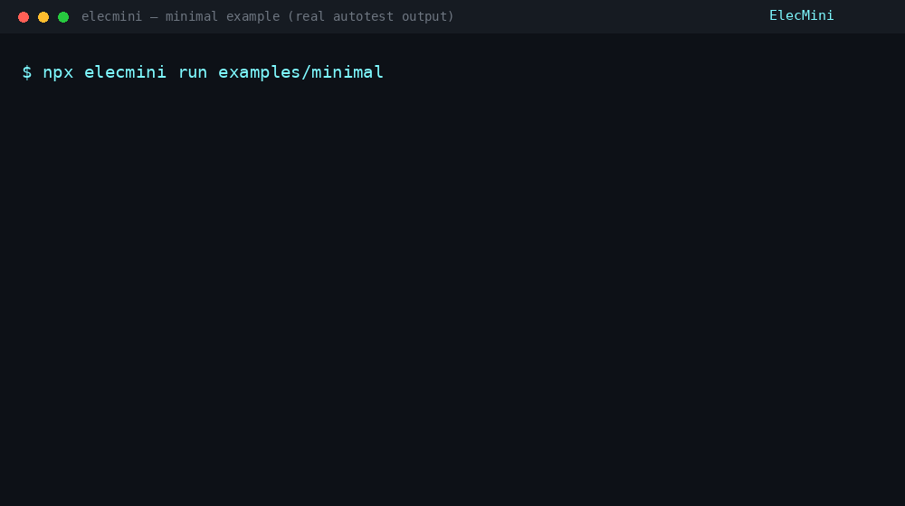

<div align="center">


# ElecMini

**保留 Electron 的 JS API 契约，去掉 Chromium，改用系统 WebView 渲染的桌面运行时。**

[](https://github.com/outman2008/elecmini/actions/workflows/ci.yml)
[](https://www.npmjs.com/package/elecmini)
[](./LICENSE)
[](#平台支持)

[English](./README.en.md) · 中文

</div>

---

## ElecMini 是什么？它解决什么问题？

ElecMini **不是** Electron 的分支，而是一套**兼容层**：业务代码继续 `require('electron')`，底层由 **Rust 宿主（tao 窗口 + wry WebView）+ Node sidecar** 承载，渲染改用**系统 WebView**（WebView2 / WKWebView / WebKitGTK），不再随应用分发 Chromium。

它解决的是一个明确的问题：如果你要的是**更小的安装包、更快的冷启动、复用系统渲染器**，但又不愿重写已有 Electron 应用的 API 调用，ElecMini 提供一条低改造成本的迁移路径。

> 💡 **先看收益**：ElecMini 把安装包从 Electron 的 **~274MB 压到 Slim ~84MB**——体积约为原来的 **1/3（缩小约 3 倍）**。原因是它不随应用分发 Chromium，而是复用系统自带的 WebView。业务代码继续 `require('electron')`，冷启动也更快，迁移成本低。

## 特性

- **API 契约兼容**：基于 Electron 官方 `electron.d.ts`（45.x）做表面审计，核心 20 个模块、984 个成员**表面 100% 覆盖**，并按语义严格分级（native / mirror / degraded）。
- **系统 WebView 渲染**：Windows 用 WebView2、macOS 用 WKWebView、Linux 用 WebKitGTK，不打包 Chromium。
- **Node sidecar 进程模型**：Node 跑业务主进程、Rust 跑窗口与 WebView，两者通过 JSONL JSON-RPC 通信。
- **迁移评估工具链**：静态 AST 扫描 → Go/No-Go 预判 → 自动生成运行时探针 → 差分契约测试，把"能不能迁"变成可复现流程。
- **启动门禁与降级**：按系统 WebView 版本分级（L0/L1/L2/L3），缺失能力时明确提示，绝不白屏。
- **打包与分发**：Slim / Full 双 SKU、代码签名、自动更新（含验签与回滚）、灰度分桶。
- **安全加固**：host 侧导航 origin 锚定 + IPC 来源校验，可选 `ELECMINI_STRICT_NAV=1` 严格阻断异源导航。

## 和 Electron / Tauri 相比该怎么选？

| 维度 | Electron | Tauri | ElecMini |
|---|---|---|---|
| 渲染引擎 | 内置 Chromium | 系统 WebView | 系统 WebView |
| 主进程语言 | Node.js | Rust | Node.js（sidecar） |
| 安装包体 | 大（含 Chromium，~274MB） | 小 | 小（Slim ~84MB，约为 Electron 的 **1/3，缩小约 3 倍**） |
| Electron JS API | 原生 | 无，需重写 | 兼容层（表面 100%，分级语义） |
| 现有 Electron 应用迁移 | — | 需重写主进程 | 低改造成本（复用 `require('electron')`） |

一句话定位：**Tauri 面向新写应用（Rust 主进程），ElecMini 面向存量 Electron 应用的低成本迁移。**



> 上图对比的是**随应用捆绑的引擎体积**（274MB → 2.3MB，约 118 倍），而**完整安装包**口径为 Electron ~274MB vs ElecMini Slim ~84MB，约为 **1/3（缩小约 3 倍）**。两种口径都指向同一事实：ElecMini 不打包 Chromium，而是复用系统已安装的 WebView（共享依赖）。数据在 Linux x64 上实测。

## 架构

```
目标应用 (main.js / preload.js)
        │  require('electron')  → shim（runtime/electron.js）
        ▼
   Node sidecar（runtime/launcher.js）──JSONL JSON-RPC──▶ Rust host（host/src/main.rs）
        │                                                      │ tao 窗口 + wry WebView
        │                                                      ▼
        └──────────────  本地静态服务 http://127.0.0.1:port  ──▶ 系统 WebView 渲染页面
```

- **渲染层 preload**：`runtime/preload-runtime.js` 经 initialization script 注入，提供受限 `require('electron')` / `contextBridge` / `ipcRenderer`。
- **契约补齐层**：`runtime/contract-fill.js` 让官方 `electron.d.ts` 声明的成员都存在，并严格标记 native / mirror / degraded 三级。
- **迁移工具**：`migrate/assess.js` 静态扫描目标项目 → Go/No-Go 预判；`migrate/gen-probe.js` 生成运行时探针。

## 快速开始

前置：Node 22、Rust stable；Linux 需 `libwebkit2gtk-4.1-dev`（macOS / Windows 用系统自带 WebView）。

```bash
# 1) 克隆并构建 Rust host（只需一次）
git clone https://github.com/outman2008/elecmini.git && cd elecmini
cargo build --release -p elecmini-host --bin elecmini-host

# 2) 跑最小示例（一个窗口 + 一次 IPC 往返）
npx elecmini run examples/minimal
# 或直接：
node runtime/launcher.js examples/minimal

# 3) 迁移评估：静态扫描你现有的 Electron 应用
npx elecmini assess --project <你的应用目录>

# 4) 检查
npx elecmini check --quick     # 快速：跳过编译 / E2E
npx elecmini check             # 全量（Linux 需 xvfb-run）
```

> CLI 装好后还有 `elecmini run / assess / probe / audit / check` 子命令，`elecmini --help` 查看。
> 最小示例见 [`examples/minimal/`](./examples/minimal/)。



> 演示为真实 autotest 的终端输出（门禁 L0 → host ready → `ipcRenderer.invoke('ping')` → `PING_RESULT` → 类型封装往返 → 退出）。
> 因无头 CI 环境无法抓取 WebKitGTK 窗口画面，此处以终端实测输出呈现，所有行均来自实际运行日志。

## API 支持分哪几档？

表面覆盖 ≠ 语义完整。Electron 45.4.1 官方类型定义共 **984 个成员**（50 个导出）。
ElecMini 对其中**核心 20 个模块**的成员做了逐项语义分级，共 525 项：

| 分级 | 数量 | 含义 |
|---|---|---|
| **native** | 113 | 真原生实现，行为对齐 Electron |
| **mirror** | 327 | 状态镜像 / 轻量封装，可用性高 |
| **degraded** | 85 | 降级桩：返回类型正确的安全默认值，或平台专属边界 |

> 说明：984 是**全部**官方成员数（含非核心模块），上表 525 是核心集的**已分级**成员数。
> 核心 20 模块的成员表面覆盖为 100%；未纳入核心集的其余导出成员不保证可用。

分级由 `node migrate/api-surface/audit.js` 实时生成；完整不支持清单见 [`docs/unsupported-apis.md`](./docs/unsupported-apis.md)。迁移前务必运行 `node migrate/assess.js --project <appDir>`。

## 平台支持

| 平台 | WebView | 编译 | DevTools 后端 | E2E 验证 |
|---|---|---|---|---|
| Windows | WebView2 | ✅ | WebView2 CDP（含命令协议） | ✅ 真机全套（安全加固 22/22、差分契约 42/42） |
| macOS | WKWebView | ✅ | WKWebView 私有 API | CI 编译 + 单测；运行时需 macOS 机器 |
| Linux | WebKitGTK | ✅ | WebKitWebInspector | ✅ 全量（差分 42/42、E2E；需 `xvfb-run`） |

> **CDP 命令协议**（`webContents.debugger.sendCommand`）仅 Windows 原生支持——CDP 是 Chromium 私有协议，WebKit 无等价协议。DevTools 检查器窗口三平台均可用（macOS 用私有 API，故 release 构建显式启用 wry `devtools` feature；上架 App Store 时需评估私有 API 合规）。

> 差分的 42 个用例中有 17 个依赖真实窗口 / 屏幕 / session，**必须在有显示环境**下运行
> （Linux 用 `xvfb-run`，Windows 为真机桌面）；无显示环境下这些用例不写盘，实际只比对 25 个。

## 有哪些已知边界和限制？

- **无 Electron 级 contextIsolation**：preload 与页面同 realm；隔离依赖 host 侧 origin 锚定 + IPC 来源校验。**不要**把它当作安全沙箱使用。
- **同步 API 降级**：`sendSync` 返回 `undefined`、`showMessageBoxSync` 返回 `defaultId` 等——类型正确但不是真实交互结果，需改写为异步。
- **架构不可补**：Chromium 扩展体系、`@electron/remote` 明确不支持。
- **CDP 命令协议**（`webContents.debugger.sendCommand`）仅 Windows WebView2 原生支持——CDP 是 Chromium 私有协议，WebKit 生态没有等价协议。**DevTools 调试窗口**则三平台可用：`openDevTools()` 在 Windows 走 WebView2、macOS 走 WKWebView 私有 API、Linux 走 WebKitWebInspector。macOS/Linux 的远程调试用 Web Inspector Protocol（Safari Develop 菜单 / `WEBKIT_INSPECTOR_SERVER`），不是 CDP。
- **L0 ≥95% 的 Go/No-Go 结论**仍需生产遥测样本（当前本地样本远低于统计最小样本 385）。

## 文档索引

| 主题 | 文档 |
|---|---|
| 最小示例 | [`examples/minimal/`](./examples/minimal/) |
| 迁移评估手册 | [`migrate/README.md`](./migrate/README.md) |
| 不支持 API 清单 | [`docs/unsupported-apis.md`](./docs/unsupported-apis.md) |
| API 表面审计工具 | [`migrate/api-surface/audit.js`](./migrate/api-surface/audit.js) |
| 运行时（Node sidecar） | [`runtime/README.md`](./runtime/README.md) |
| 原生宿主（Rust） | [`host/README.md`](./host/README.md) |
| 差分契约测试 | [`contract/README.md`](./contract/README.md) |
| 打包 / 签名 / 更新 | [`pack/README.md`](./pack/README.md) |
| 兼容性基线 | [`compat/README.md`](./compat/README.md) |
| API 兼容层与扫描器 | [`shim/README.md`](./shim/README.md) |
| 测试夹具 | [`tests/README.md`](./tests/README.md) |
| 检查脚本 | [`ci/README.md`](./ci/README.md) |
| 版本变更记录 | [`CHANGELOG.md`](./CHANGELOG.md) |
| 贡献指南 | [`CONTRIBUTING.md`](./CONTRIBUTING.md) |
| 安全策略 | [`SECURITY.md`](./SECURITY.md) |

## License

[MIT](./LICENSE) © ElecMini contributors
